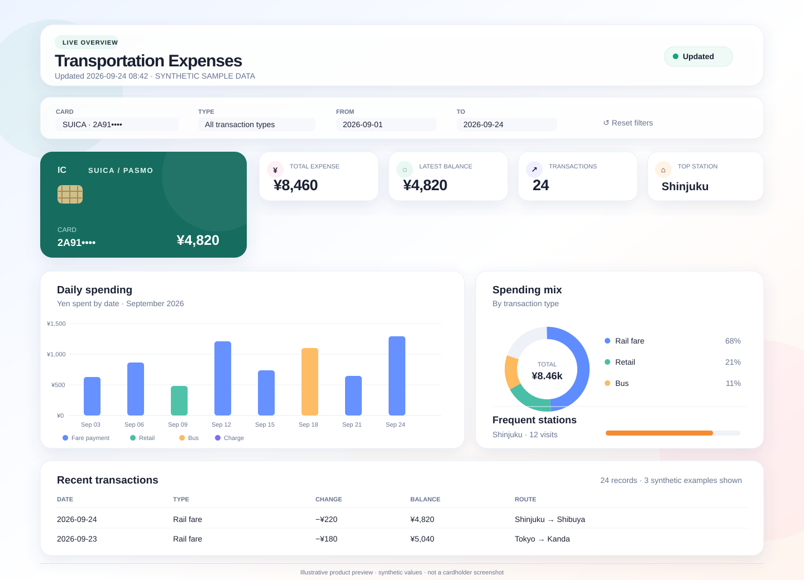
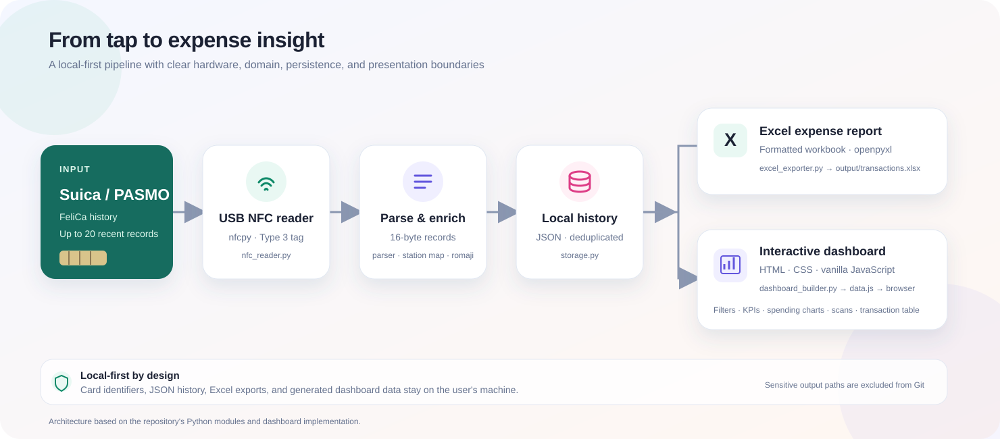

<p align="center">
  
</p>

<h1 align="center">Transportation Expenses Tracker</h1>

<p align="center">
  Turn Suica and PASMO transit-card history into a durable local ledger, an Excel expense report, and an interactive dashboard.
</p>

<p align="center">
  
  
  
  
</p>

<p align="center">
  <a href="#overview">Overview</a> ·
  <a href="#architecture">Architecture</a> ·
  <a href="#quick-start">Quick start</a> ·
  <a href="#privacy">Privacy</a>
</p>

---

## Overview

A small, end-to-end data product for turning the recent transaction history stored on a physical transit card into useful expense records. The application reads FeliCa history through a USB NFC reader, parses the card's compact records, enriches station codes, maintains a deduplicated local history, and presents the results in Excel and a browser dashboard.

The preview above follows the real dashboard layout and uses **synthetic values only**; it contains no cardholder or trip data.

### What it delivers

| Capability | Implementation |
| --- | --- |
| Card ingestion | `nfcpy` reads FeliCa / NFC Type 3 history from a compatible USB reader. |
| Record decoding | Parses 16-byte history blocks, transaction types, dates, balances, and station codes. |
| Station enrichment | Resolves Cybernet station codes from the included `ekicode.csv` catalog and romanizes Japanese names with `pykakasi`. |
| Durable history | Merges scans into a local JSON store and tracks new, duplicate, and total records per scan. |
| Expense export | Produces a formatted `.xlsx` workbook with `openpyxl`. |
| Local analytics | Generates a static HTML/CSS/JavaScript dashboard with filters, KPIs, spending charts, scan history, and transaction details. |

## Architecture

The flow keeps the hardware boundary, domain parsing, local persistence, and presentation layers separate.

<p align="center">
  
</p>

1. **Read:** `read.py` opens the NFC reader and delegates card communication to `nfc_reader.py`.
2. **Parse and enrich:** `suica_parser.py` decodes the card records; `station_resolver.py` maps station codes and `romanizer.py` converts Japanese names.
3. **Persist:** `storage.py` merges each scan into `output/transactions.json` and deduplicates records.
4. **Publish locally:** `excel_exporter.py` writes the workbook; `dashboard_builder.py` creates the local dashboard payload consumed by the static frontend.

For the byte layout, storage model, and implementation details, see [the technical documentation](docs/documentation.md).

## Quick start

### Requirements

- Python 3.10 or newer
- Windows for the documented USB-reader setup
- A compatible Sony RC-S330 / RC-S380 FeliCa reader
- The USB reader configured with the WinUSB driver so `nfcpy` can access it

The parser, storage, export, and dashboard tests run without an NFC reader. Hardware access is only required to scan a physical card.

### Install

```powershell
python -m venv .venv
.venv\Scripts\Activate.ps1
python -m pip install -r requirements.txt
```

On Windows, configure the reader with WinUSB before the first scan. See [the hardware and data notes](docs/documentation.md#setup).

### Scan and export

Connect the reader, place a card on it, then run from the repository root:

```powershell
python read.py
```

The default reader path is `usb:054c:02e1`. To select a different `nfcpy` device path or skip the Excel export:

```powershell
python read.py --reader usb:054c:02e1
python read.py --no-excel
```

A successful scan updates the local JSON history, the Excel workbook, and `dashboard/data.js`.

### Open the dashboard

```powershell
python -m http.server 4173 --bind 127.0.0.1 --directory dashboard
```

Open <http://127.0.0.1:4173/> in a browser. The dashboard reads the generated `data.js` file; run a scan first to populate it.

### Run the test suite

```powershell
python -m unittest discover -s tests -v
```

## Data model and constraints

A physical card exposes only its latest **20 history records**. The local JSON store preserves records across scans, but it cannot recover a transaction that has already rolled off the card before it was scanned. Scan regularly to build a more complete history.

Station names depend on the static Cybernet station-code catalog at `data/ekicode.csv`. If a code is missing or a route is unsupported, the dashboard can show an unresolved station code instead. The source project for the station catalog is credited in the documentation.

## Privacy

Card identifiers and trip histories are sensitive personal data. This project keeps its working database and generated reports on the local machine; it has no cloud-sync workflow.

- Keep `output/transactions.json`, `output/transactions.xlsx`, and `dashboard/data.js` out of commits. The repository `.gitignore` excludes these generated files.
- Use synthetic or anonymized values in screenshots, issues, and demo recordings.
- Review `git status` before every commit, especially after a real card scan.

## Repository map

```text
transportation-expenses-tracker/
├── read.py                         # CLI entry point and orchestration
├── src/transportation/
│   ├── nfc_reader.py               # NFC reader boundary
│   ├── suica_parser.py              # Record decoding and balance changes
│   ├── station_resolver.py          # Station lookup and enrichment
│   ├── storage.py                   # Local persistence and deduplication
│   ├── excel_exporter.py            # Workbook generation
│   └── dashboard_builder.py         # Dashboard data generation
├── dashboard/                       # Static dashboard frontend
├── data/ekicode.csv                 # Station-code catalog
├── tests/                            # Parser, storage, and romanization tests
└── docs/documentation.md            # Detailed technical documentation
```

## Technology

**Python · nfcpy · FeliCa / NFC Type 3 · openpyxl · pykakasi · HTML · CSS · Vanilla JavaScript**

---

<p align="center">
  Built as a local-first transportation expense and data-visualization project.
</p>


